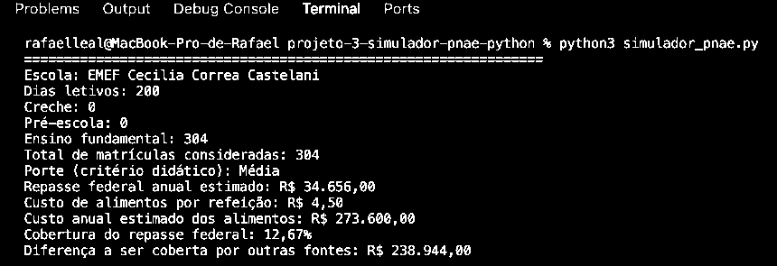
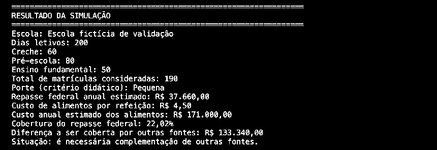

# Projeto 3 — Simulador de Repasse do PNAE em Python

**Disciplina:** Análise de Dados para Pesquisas em Políticas Públicas (CGAPN)  
**Professora:** Érica Siqueira · **Período:** 2º semestre de 2026  
**Grupo:** 7

## Objetivo

Este programa simula o repasse federal anual do Programa Nacional de Alimentação Escolar (PNAE) para uma escola, considerando as matrículas de creche, pré-escola e ensino fundamental e 200 dias letivos. Também compara o repasse estimado a uma referência pesquisada para o **custo dos alimentos de uma refeição**, calcula a porcentagem coberta pela União e identifica a diferença que precisaria ser financiada por outras fontes. Os valores são **estimativas didáticas**, e não o repasse efetivamente recebido pela escola.

## Como usar

1. Baixe `simulador_pnae.py` e abra um terminal na pasta do arquivo.
2. Execute:

   ```bash
   python simulador_pnae.py
   ```
4. Digite o nome da escola e as matrículas de **creche**, **pré-escola** e **ensino fundamental**, sempre como números inteiros iguais ou maiores que zero. Para etapas não oferecidas pela escola, digite **0**.
5. Leia o total de matrículas, o porte, o repasse anual, o custo anual estimado dos alimentos, a cobertura percentual e a diferença a complementar.

O programa utiliza as constantes `DIAS_LETIVOS`, `PER_CAPITA_CRECHE`, `PER_CAPITA_PRE_ESCOLA`, `PER_CAPITA_FUNDAMENTAL` e `CUSTO_ALIMENTOS_REFEICAO` no início do arquivo.

## Prints do resultado

**Execução com escola real — Censo Escolar 2024:**



**Teste de validação do Projeto 1:**



Os resultados também estão preservados em `prints/saida_escola_real.txt` e `prints/saida_validacao_projeto1.txt` para conferência.

## Escola simulada

| Informação | Dado verificado no arquivo do Censo 2024 |
|---|---|
| Escola | CECILIA CORREA CASTELANI PROFA EMEF |
| Código INEP | **35217116** |
| Município | **Osasco** |
| UF | **SP** |
| Dependência administrativa | **Municipal** (`TP_DEPENDENCIA = 3`) |
| Situação de funcionamento | **Em atividade** (`TP_SITUACAO_FUNCIONAMENTO = 1`) |
| Matrículas em creche | **0** |
| Matrículas em pré-escola | **0** |
| Matrículas no ensino fundamental | **304** (`QT_MAT_FUND = 304`) |
| Matrículas na educação básica | **304** (`QT_MAT_BAS = 304`) |

### Como encontramos os dados no Censo

Foi utilizado o arquivo disponibilizado na disciplina **`Censo_2024_Excel.rar`**, que contém a planilha **`Censo_2024_Excel.xlsx`**. No conjunto de escolas, foram identificadas as colunas `NO_ENTIDADE` (nome), `CO_ENTIDADE` (código INEP), `NO_MUNICIPIO` (município), `SG_UF` (sigla da UF), `TP_DEPENDENCIA` (dependência), `TP_SITUACAO_FUNCIONAMENTO` (funcionamento), `QT_MAT_INF` (matrículas da educação infantil), `QT_MAT_FUND` (matrículas do ensino fundamental) e `QT_MAT_BAS` (total da educação básica).

O procedimento foi:

1. Filtrar `SG_UF = SP` e `NO_MUNICIPIO = Osasco`.
2. Localizar a linha com `CO_ENTIDADE = 35217116`.
3. Confirmar que `TP_DEPENDENCIA = 3` (municipal) e `TP_SITUACAO_FUNCIONAMENTO = 1` (em atividade).
4. Ler `QT_MAT_INF = 0`, `QT_MAT_FUND = 304` e `QT_MAT_BAS = 304`.
5. Informar **0** para creche e pré-escola, pois a escola não apresenta matrículas de educação infantil, e **304** para o ensino fundamental.

A planilha fornecida agrega educação infantil em `QT_MAT_INF`; ela não possui, nessa versão tratada, colunas separadas para creche e pré-escola. A escolha de uma escola com `QT_MAT_INF = 0` evita inferir uma divisão não observada. Para outros estabelecimentos com matrículas em educação infantil, seria necessário consultar o recorte detalhado de matrículas do Censo antes de preencher essas duas etapas.

**Fonte oficial do conjunto de dados:** [INEP — Microdados do Censo Escolar (edição 2024)](https://www.gov.br/inep/pt-br/acesso-a-informacao/dados-abertos/microdados/censo-escolar). A seleção acima foi verificada na planilha consolidada entregue para a atividade.

## Custo dos alimentos por refeição

**Valor adotado: R$ 4,50 por refeição (somente alimentos).**

**Fonte pesquisada:** Costa, G. M. e colaboradores. *Custo-efetividade de lanches e refeições na alimentação escolar de um município do Sul do Brasil*. **Cadernos de Saúde Pública**, v. 41, n. 9, publicado em **19 de setembro de 2025**. O estudo analisou cardápios servidos em **2021** a estudantes do **ensino fundamental** da rede municipal de **Morro da Fumaça (Santa Catarina)**. Na **Tabela 1**, a mediana do custo direto dos alimentos usados nas **refeições** foi de **R$ 4,50**, diferente do custo dos lanches. Os custos foram calculados com quantidades e preços dos ingredientes das preparações, não como custo completo de equipe e estrutura.

**Link:** https://pmc.ncbi.nlm.nih.gov/articles/PMC12448751/

**Justificativa:** o valor provém de pesquisa com preços de ingredientes efetivamente adquiridos para alimentação escolar e considera a mesma etapa de ensino da escola escolhida (fundamental). Por isso, é uma referência transparente para o exercício de estimar a cobertura do repasse federal.

## Resultados e reflexão

### Teste do simulador do Projeto 1

Com **60 matrículas de creche**, **80 de pré-escola**, **50 de ensino fundamental** e **200 dias letivos**, o repasse federal anual calculado é **R$ 37.660,00**, e a escola é classificada como **Pequena**. Isso reproduz o resultado exigido na orientação do Projeto 3. As matrículas desse teste são fictícias.

### Escola real do Censo 2024

| Indicador | Valor |
|---|---:|
| Matrículas consideradas | **304** |
| Porte pelo critério didático | **Média** |
| Repasse federal anual estimado | **R$ 34.656,00** |
| Referência de alimentos por refeição | **R$ 4,50** |
| Custo anual dos alimentos: 304 × 200 × R$ 4,50 | **R$ 273.600,00** |
| **Cobertura federal estimada** | **12,67%** |
| **Diferença a ser coberta por outras fontes** | **R$ 238.944,00** |

**Fórmulas empregadas:**

- Repasse federal: `(creche × 1,57 + pré-escola × 0,82 + fundamental × 0,57) × 200`;
- Custo anual dos alimentos: `(creche + pré-escola + fundamental) × 200 × 4,50`;
- Cobertura percentual: `repasse federal ÷ custo anual × 100`;
- Diferença a complementar: `máximo(0, custo anual − repasse federal)`.

### Reflexão sobre financiamento

Na simulação, o repasse federal cobre **12,67%** do custo estimado dos alimentos para os 304 alunos, enquanto os **87,33%** restantes dependeriam de outras fontes de financiamento. Esse resultado é uma estimativa, pois utiliza uma referência de custo de outro município e período.

As leituras do **Todos Pela Educação (2023)**, do **Observatório da Alimentação Escolar (2025)** e do **Brasil de Fato (2025)** destacam a importância dos reajustes do PNAE e da complementação financeira por estados e municípios. Apesar do reajuste federal de fevereiro de 2026, uma complementação insuficiente pode comprometer a qualidade, a variedade e a regularidade da alimentação escolar.

**Simplificações adotadas:** matrículas de 2024, valores per capita de 2026, três etapas de ensino (creche, pré-escola e fundamental), 200 dias letivos, uma refeição diária por aluno, custo fixo exclusivamente dos alimentos e classificação didática do porte escolar.

**Simplificações adotadas:** matrículas de **2024** combinadas com per capita federal de **2026**; somente três etapas (creche, pré-escola e fundamental); **200 dias letivos**; **uma refeição por aluno por dia**; custos diretos dos alimentos, sem pessoal, gás, infraestrutura ou equipamentos; valor único por refeição, mesmo entre etapas; classificação de porte **didática, não oficial do PNAE**.

### Leituras de apoio solicitadas

1. Todos Pela Educação. *Cenários para a recomposição orçamentária e o fortalecimento do PNAE*. Março de 2023. https://todospelaeducacao.org.br/wordpress/wp-content/uploads/2023/03/nota-pnae-reajuste-nos-valores-do-programa-nacional-de-alimentacao-escolar.pdf
2. Observatório da Alimentação Escolar. *Apesar de ousadas novas metas, ausência de reajuste ameaça a alimentação escolar*. 21 de outubro de 2025. https://alimentacaoescolar.org.br/noticias/2025/10/21/apesar-de-ousadas-novas-metas-ausencia-de-reajuste-ameaca-a-alimentacao-escolar/
3. Brasil de Fato. *Alimentação escolar: Brasil ainda enfrenta desafio do financiamento, diz estudo*. 16 de outubro de 2025. https://www.brasildefato.com.br/podcast/bem-viver/2025/10/16/alimentacao-escolar-brasil-ainda-enfrenta-desafio-do-financiamento-diz-estudo/

## Organização do programa

| Parte/função | O que faz | Correspondência ao Projeto 1 em Excel |
|---|---|---|
| Constantes do início do arquivo | Define dias letivos, valores per capita e custo de referência dos alimentos | Aba de parâmetros do PNAE |
| `ler_numero` | Solicita e valida matrículas inteiras não negativas | Entradas de matrícula na planilha |
| `calcular_repasse` | Calcula o repasse por etapa e soma | `PROCV` dos valores por modalidade e `SOMARPRODUTO` |
| `classificar_porte` | Classifica em Pequena (até 200), Média (201 a 400) ou Grande (acima de 400) | `PROCV` aproximado / tabela didática de porte |
| `calcular_cobertura` | Calcula custo dos alimentos, cobertura (%) e diferença; usa `if` para zerar a diferença quando o repasse cobre o custo | Nova análise, inexistente no Projeto 1 |
| `formatar_reais` | Exibe os montantes com formatação monetária brasileira | Formatação de células como moeda |
| `main` | Lê as matrículas e mostra os resultados no terminal | Uso do simulador e leitura dos resultados na planilha |

Para repetir os testes de cálculo, execute `python testes/testar_simulador.py`.

## Uso de Inteligência Artificial

**Ferramenta utilizada:** ChatGPT (OpenAI).

**Para que foi usada:** apoio à análise do enunciado, organização de fontes públicas, adaptação do simulador para as três etapas de ensino exigidas,  preparação de testes e elaboração inicial da documentação.


## Fonte de Dados

**Fontes oficiais:**

- **INEP — Censo Escolar 2024**, microdados e dicionário de dados: https://www.gov.br/inep/pt-br/acesso-a-informacao/dados-abertos/microdados/censo-escolar
- **FNDE — Resolução CD/FNDE nº 1, de 18 de fevereiro de 2026**, para os per capita de creche (**R$ 1,57**), pré-escola (**R$ 0,82**) e fundamental (**R$ 0,57**): https://www.gov.br/fnde/pt-br/acesso-a-informacao/acoes-e-programas/programas/pnae

**O que os dados representam:** os registros do Censo Escolar identificam escolas e informam a situação de funcionamento, dependência administrativa e números de matrículas declarados em **2024**. A aplicação dos valores diários federais de **2026** e de 200 dias resulta em uma **estimativa de repasse**, não em transferências verificadas no sistema de pagamentos do FNDE.

**Estrutura utilizada:** `NO_ENTIDADE` (nome); `CO_ENTIDADE` (código INEP); `NO_MUNICIPIO` (município); `SG_UF` (UF); `TP_DEPENDENCIA` (rede); `TP_SITUACAO_FUNCIONAMENTO` (situação); `QT_MAT_INF` (educação infantil, agregado); `QT_MAT_FUND` (fundamental); `QT_MAT_BAS` (educação básica total). A base foi consultada na planilha da disciplina `Censo_2024_Excel.xlsx`.

**Custo dos alimentos:** R$ 4,50 por refeição principal, estudo de **2021** publicado em **19/09/2025**, em município de SC; https://pmc.ncbi.nlm.nih.gov/articles/PMC12448751/. Não é cotação de Osasco.

## Participação do Grupo

**O que aprendemos com este projeto:** Esse trabalho nos deu a possibilidade de comparar os repasses federais por etapa de ensino com uma referência documentada de custo de ingredientes; também exercita entrada e validação de dados, funções, operações aritméticas, estruturas condicionais e documentação reprodutível em Python. A comparação mostrou também por que o resultado é uma estimativa e depende da qualidade dos dados e da fonte de custos adotada.

**Divisão de responsabilidades informada pelo grupo:**

- **Rafael Leal:** desenvolvimento do simulador em Python.
- **José Antonio:** pesquisa e seleção da escola no Censo Escolar 2024.
- **João Henrique:** pesquisa do custo dos alimentos e levantamento das fontes.
- **Pedro de Marco:** testes, conferência dos cálculos e preparação dos prints.
- **Pedro Giorgi:** documentação no README, reflexão e organização no GitHub.


