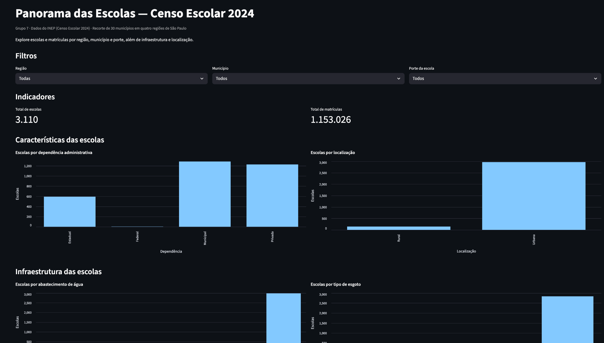
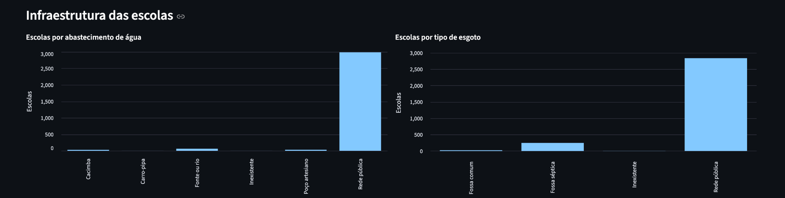
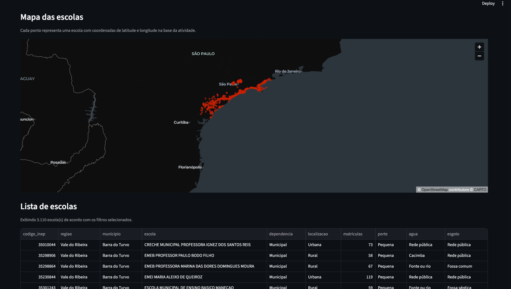
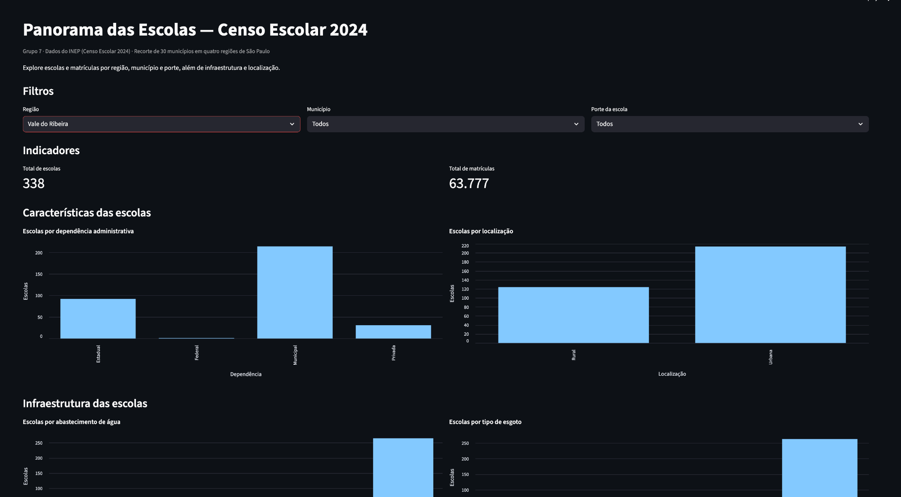
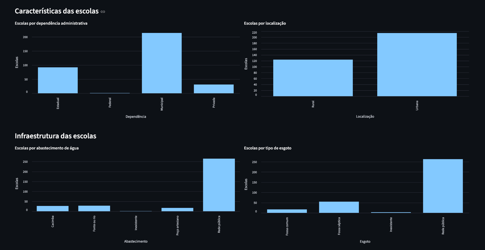
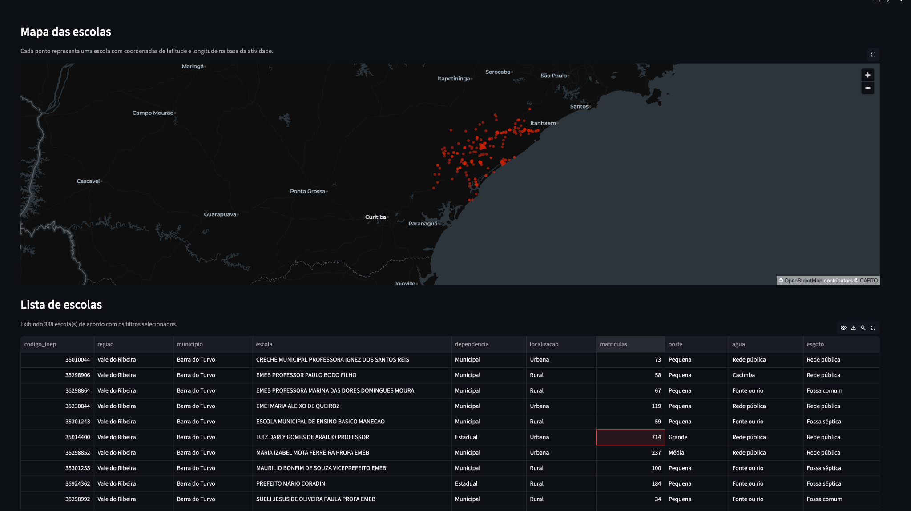

# Projeto 4 — Painel Interativo do Censo Escolar 2024 em Python

**Disciplina:** Análise de Dados para Pesquisas em Políticas Públicas (CGAPN)  
**Professora:** Érica Siqueira  
**Período:** 2º semestre de 2026  
**Grupo:** 7

## Objetivo

Este projeto apresenta um painel interativo desenvolvido com **Python, pandas e Streamlit** para explorar características, infraestrutura e distribuição geográfica de escolas em atividade do **Censo Escolar 2024**. A análise utiliza o recorte disponibilizado na disciplina, com **3.110 escolas de 30 municípios de quatro regiões do estado de São Paulo**, e permite comparar os resultados por região, município e porte da escola.

O painel dá continuidade ao **Projeto 2**, que utilizou Excel, Power Query, tabelas e gráficos dinâmicos e segmentações de dados. Nesta versão, os filtros e as visualizações são produzidos diretamente em Python e apresentados no navegador.

## Como usar

### Arquivos necessários

Mantenha `painel.py` e `escolas_sp_regioes_2024_geo.csv` **na mesma pasta**. O código lê o CSV automaticamente a partir da pasta onde está o script.

### Instalação e execução

1. Tenha **Python 3** instalado no computador.
2. Abra a pasta `projeto-4-painel-censo-python` no VS Code ou em outro editor e abra um terminal nessa pasta.
3. Instale os pacotes necessários:

   ```bash
   python -m pip install pandas streamlit
   ```

4. Inicie o painel:

   ```bash
   python -m streamlit run painel.py
   ```

5. Abra o painel no navegador e utilize os filtros de **Região**, **Município** e **Porte da escola** para selecionar os dados desejados. Os indicadores, gráficos, mapa e lista de escolas serão atualizados automaticamente.

## Prints do resultado

As capturas abaixo registram duas combinações de filtros durante a execução local do Streamlit. Em ambos os cenários, município e porte permanecem em "Todos".

### Cenário 1 — Todas as regiões

O painel apresenta **3.110 escolas e 1.153.026 matrículas** no recorte de 30 municípios.

**Título, filtros, indicadores e gráficos de características:**



**Gráficos de infraestrutura:**



**Mapa e lista de escolas:**



### Cenário 2 — Vale do Ribeira

Com o filtro regional aplicado, o painel apresenta **338 escolas e 63.777 matrículas**.

**Título, filtros e indicadores:**



**Gráficos de características e infraestrutura:**



**Mapa e lista de escolas:**




## Elementos do painel

| Tipo | Elemento exibido | Coluna(s) utilizada(s) ou cálculo |
|---|---|---|
| Indicador 1 | Total de escolas | Número de registros após os filtros (`len(censo)`) |
| Indicador 2 | Total de matrículas | Soma da coluna `matriculas` |
| Filtro 1 | Região | `regiao` |
| Filtro 2 | Município (dependente da região) | `municipio` |
| Filtro 3 | Porte da escola | `porte`, criado a partir de `matriculas` |
| Gráfico de características 1 | Escolas por dependência administrativa | `dependencia` |
| Gráfico de características 2 | Escolas por localização | `localizacao` |
| Gráfico de infraestrutura 1 | Escolas por abastecimento de água | `agua` |
| Gráfico de infraestrutura 2 | Escolas por tipo de esgoto | `esgoto` |
| Mapa | Um ponto para cada escola filtrada | `latitude` e `longitude` |
| Lista | Identificação e dados das escolas filtradas | `codigo_inep`, `regiao`, `municipio`, `escola`, `dependencia`, `localizacao`, `matriculas`, `porte`, `agua`, `esgoto` |

A classificação **Pequena, Média e Grande** é didática, criada pela função `classificar_porte`: até **200 matrículas**, de **201 a 400 matrículas** e acima de **400 matrículas**, respectivamente. Essas faixas não devem ser confundidas com uma classificação oficial do INEP.

## O que o painel mostra

A seleção dos municípios evidencia diferenças mesmo dentro de uma mesma região. Com o filtro de **porte Média** no **Vale do Ribeira**, **Barra do Turvo** apresenta 1 escola e 237 matrículas, enquanto **Cananéia** apresenta 4 escolas e 1.086 matrículas. Ao selecionar a região inteira, sem restrições de município ou porte, o painel apresenta **338 escolas e 63.777 matrículas no Vale do Ribeira**. Para comparação, o recorte da **Região Metropolitana de SP** apresenta **1.263 escolas e 572.377 matrículas**. Essas contagens dizem respeito **somente aos municípios incluídos na base da disciplina**, e não à totalidade de cada região administrativa.

## Organização do programa

| Parte do código | Função no projeto | Correspondência com o Projeto 2 em Excel |
|---|---|---|
| `classificar_porte()` | Classifica as escolas pelo total de matrículas | Coluna calculada de porte da escola |
| `carregar_dados()` e `pd.read_csv()` | Carrega o arquivo CSV e cria a coluna `porte` | Carregamento, tratamento e preparação da base com Power Query |
| `st.selectbox()` e seleção do `censo` | Aplica filtros de região, município e porte | Segmentações de dados do dashboard |
| `st.metric()` | Mostra total de escolas e de matrículas | Indicadores do painel do Excel |
| `value_counts()` e `st.bar_chart()` | Conta escolas por característica e infraestrutura e cria os quatro gráficos | Tabelas dinâmicas e gráficos dinâmicos |
| `st.map()` | Plota no mapa as coordenadas das escolas filtradas | Análise visual da localização das escolas (recurso acrescentado no Python) |
| `st.dataframe()` | Exibe e ordena os registros das escolas selecionadas | Tabela de dados e consulta aos registros do painel |

A ordem do código segue a estrutura da aula: **classificação de porte, carregamento e organização dos dados, filtros, indicadores, gráficos, mapa e lista**. O código usa `@st.cache_data` para evitar releituras desnecessárias da base.

## Uso de Inteligência Artificial

**Ferramenta utilizada:** ChatGPT, da OpenAI.

**Para que foi usada:** revisão das colunas do CSV, organização dos testes e preparação do README.


## Fonte de Dados

**Fonte oficial:** Instituto Nacional de Estudos e Pesquisas Educacionais Anísio Teixeira (**INEP**) — **Censo Escolar da Educação Básica 2024**.

**Link oficial:** https://www.gov.br/inep/pt-br/acesso-a-informacao/dados-abertos/microdados/censo-escolar

**Arquivo utilizado:** `escolas_sp_regioes_2024_geo.csv`, base recortada e georreferenciada disponibilizada na disciplina, contendo escolas em atividade de 30 municípios de quatro regiões paulistas: **Região Metropolitana de SP, Baixada Santista, Litoral Norte e Vale do Ribeira**.

**O que representam os dados:** cada linha corresponde a uma escola do recorte de 2024, com identificação, matrículas, dependência administrativa, localização e informações de infraestrutura. A base da atividade também inclui coordenadas geográficas para a visualização espacial; essas coordenadas pertencem à versão tratada disponibilizada no curso. Os dados não representam necessariamente a situação atual das escolas.

**Estrutura das variáveis utilizadas:**

| Coluna | Descrição |
|---|---|
| `codigo_inep` | Código de identificação da escola |
| `escola`, `municipio`, `regiao` | Nome da escola e recorte territorial |
| `matriculas` | Total de matrículas considerado nos indicadores e na classificação de porte |
| `dependencia` | Dependência administrativa (Federal, Estadual, Municipal ou Privada) |
| `localizacao` | Localização urbana ou rural |
| `agua`, `esgoto` | Categorias de abastecimento de água e de esgotamento sanitário |
| `latitude`, `longitude` | Coordenadas usadas nos pontos do mapa |
| `porte` | Coluna calculada em Python a partir de `matriculas` |


## Participação do Grupo

**O que aprendemos com este projeto:** ao transformar o painel do Excel em uma aplicação Python, exercitamos a leitura e a filtragem de dados com pandas, a criação de indicadores e gráficos com Streamlit e a apresentação de resultados de forma interativa. Os testes mostraram como diferentes seleções afetam simultaneamente os números, os gráficos, o mapa e a lista. Também reforçaram a importância de documentar a fonte dos dados, as limitações das comparações e o processo de validação para que outras pessoas consigam reproduzir a análise.

**Papel de cada integrante — divisão definida pelo Grupo 7:**

- **Rafael Leal:** desenvolvimento do painel em Python e Streamlit, execução local e conferência do funcionamento no navegador.
- **José Antonio:** organização e tratamento dos dados do Censo Escolar 2024 com pandas.
- **João Henrique:** desenvolvimento e conferência dos filtros e dos gráficos do painel.
- **Pedro de Marco:** testes, validação dos resultados e organização das capturas de tela.
- **Pedro Giorgi:** elaboração do README, documentação e organização dos arquivos para publicação no GitHub.


